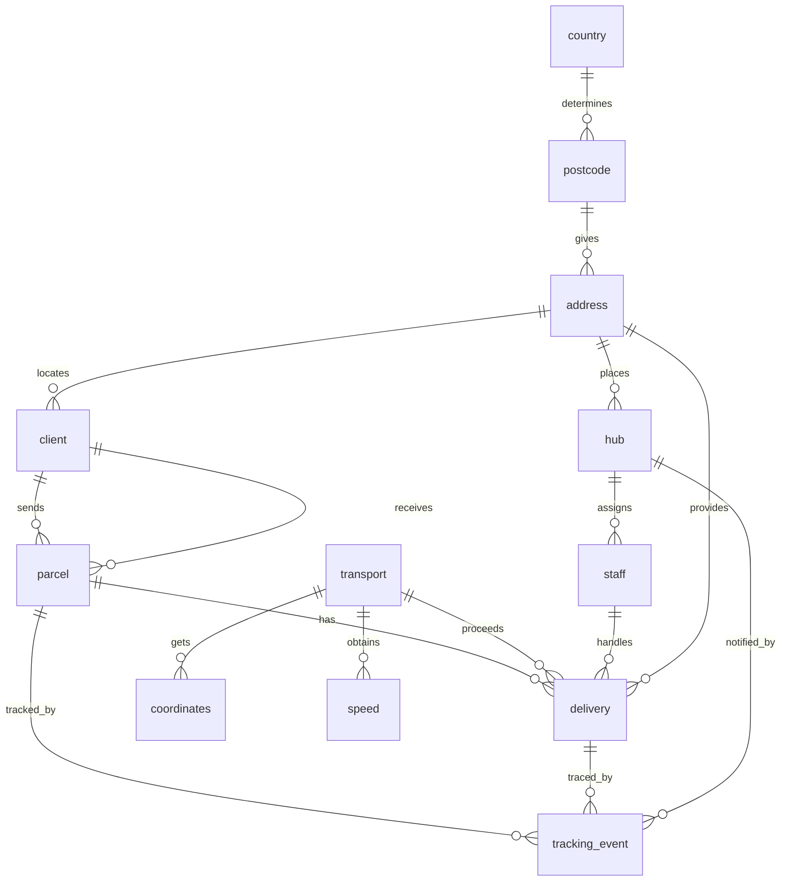
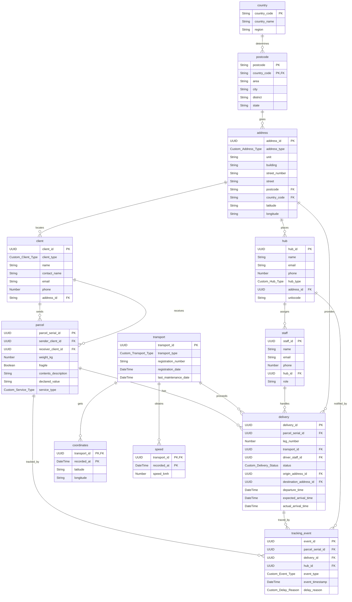

# Entities And Relationships Between Them

## Custom data types

| Type | Values |
|---|---|
| `hub_type` | AIRPORT, PORT, OFFICE, SORTING_CENTRE |
| `address_type` | HOME, BUSINESS, THIRD_PARTY_OFFICE, HUB |
| `client_type` | PERSON, BUSINESS |
| `service_type` | EXPRESS, STANDARD |
| `delivery_status` | WAITING, TRANSPORTING, ARRIVED, FAILED, POSTPONED |
| `event_type` | PICKED_UP, ARRIVED_AT_HUB, DEPARTED_HUB, CUSTOMS_HOLD, DELAYED, OUT_FOR_DELIVERY, DELIVERED, DELIVERY_FAILED |
| `delay_reason` | WEATHER, CUSTOMS, MECHANICAL, ADDRESS_ISSUE, OTHER |

## Entities (Data types are not specific to any SQL)

### country
| Column | Key | Null | Datatype | Notes |
|---|---|---|---|---|
| country_code | PK | No | String | Two-letter code |
| country_name | | No | String | |
| region | | No | String | |

### postcode
| Column | Key | Null | Datatype | Notes |
|---|---|---|---|---|
| postcode | PK | No | String | Part of composite key |
| country_code | PK, FK (country) | No | String | Part of composite key |
| area | | No | String | |
| city | | No | String | |
| district | | No | String | |
| state | | No | String | |

### address
| Column | Key | Null | Datatype | Notes |
|---|---|---|---|---|
| address_id | PK | No | UUID | |
| address_type | | No | Custom Address Type | |
| unit | | Yes | String | Floor or unit, e.g. "Level 27" |
| building | | Yes | String | |
| street_number | | Yes | String | |
| street | | No | String | |
| postcode | FK (postcode) | Yes | String | Not every place has one |
| country_code | FK (country, and postcode with postcode) | No | String | Always present |
| latitude | | Yes | String | Optional, for believable vehicle movement | 
| longitude | | Yes | String | Optional |

The pair (`postcode`, `country_code`) references `postcode`. Because `country_code` is also stored in the same row, one column carries both the country link and the postcode link, so they cannot disagree.

### client
| Column | Key | Null | Datatype | Notes |
|---|---|---|---|---|
| client_id | PK | No | UUID | |
| client_type | | No | Custom Client Type | Person or business |
| name | | No | String | Person or company name |
| contact_name | | Yes | String | Contact person for a business |
| email | | No | String | |
| phone | | No | Number | |
| address_id | FK (address) | No | String | |

### parcel
| Column | Key | Null | Datatype | Notes |
|---|---|---|---|---|
| parcel_serial_id | PK | No | UUID | |
| sender_client_id | FK (client) | No | UUID | |
| receiver_client_id | FK (client) | No | UUID | |
| weight_kg | | No | Number | |
| fragile | | No | Boolean | |
| contents_description | | No | String | Supports customs and policy questions |
| declared_value | | Yes | String | |
| service_type | | No | Custom Service Type | Affects delivery expectations |

### hub
| Column | Key | Null | Datatype | Notes |
|---|---|---|---|---|
| hub_id | PK | No | UUID | |
| name | | No | String | |
| email | | No | String | |
| phone | | No | Number | |
| hub_type | | No | Custom Hub Type | |
| address_id | FK (address) | No | UUID | Address type must be HUB |
| unlocode | | Yes | String | UN/LOCODE, e.g. MYKUL |

### staff
| Column | Key | Null | Datatype | Notes |
|---|---|---|---|---|
| staff_id | PK | No | UUID | |
| name | | No | String | |
| email | | No | String | |
| phone | | No | NUMBER | |
| hub_id | FK (hub) | No | UUID | |
| role | | No | String | |

### transport
| Column | Key | Null | Datatype | Notes |
|---|---|---|---|---|
| transport_id | PK | No | UUID | |
| transport_type | | No | Custom Transport Type | |
| registration_number | Alternate key (unique) | No | String | Natural second key |
| registration_date | | No | DateTime | |
| last_maintenance_date | | Yes | DateTime | Replaces the ambiguous "year of maintenance" |

### delivery
One row is **one parcel's leg on one vehicle**.

| Column | Key | Null | Datatype | Notes |
|---|---|---|---|---|
| delivery_id | PK | No | UUID | |
| parcel_serial_id | FK (parcel) | No | UUID | |
| leg_number | | No | Number | Unique together with `parcel_serial_id` |
| transport_id | FK (transport) | No | UUID | |
| driver_staff_id | FK (staff) | Yes | UUID | Empty for legs without a single driver |
| status | | No | Custom Delivery Status | Owns whether the leg is finished |
| origin_address_id | FK (address) | No | UUID | |
| destination_address_id | FK (address) | No | UUID | |
| departure_time | | No | DateTime | Planned or actual |
| expected_arrival_time | | No | DateTime | |
| actual_arrival_time | | Yes | DateTime | Required only when status is ARRIVED |

### tracking_event
A history table: one row per parcel event.

| Column | Key | Null | Datatype | Notes |
|---|---|---|---|---|
| event_id | PK | No | UUID | |
| parcel_serial_id | FK (parcel) | No | UUID | |
| delivery_id | FK (delivery) | Yes | UUID | Empty for events outside a leg, e.g. a hub scan |
| hub_id | FK (hub) | Yes | UUID | Where the event happened, when at a hub |
| event_type | | No | Custom Event Type | |
| event_timestamp | | No | DateTime | Orders events in time |
| delay_reason | | Yes | Custom Delay Reason | Only for DELAYED events |

### coordinates
| Column | Key | Null | Datatype | Notes |
|---|---|---|---|---|
| transport_id | PK, FK (transport) | No | UUID | |
| recorded_at | PK | No | DateTime | A value, not a foreign key |
| latitude | | No | String | |
| longitude | | No | String | |

### speed
| Column | Key | Null | Datatype | Notes |
|---|---|---|---|---|
| transport_id | PK, FK (transport) | No | UUID | |
| recorded_at | PK | No | DateTime | |
| speed_kmh | | No | Number | |

## Relationships
| Link | Result | Notes |
|---|---|---|
| Client to parcel (sender) | 1:N | |
| Client to parcel (receiver) | 1:N | |
| Parcel to transport | **M:N** | Resolved by delivery |
| Staff to transport | **M:N** | Resolved by delivery |
| Parcel to delivery | 1:N | A parcel can have several legs |
| Transport to delivery | 1:N | |
| Staff to delivery | 1:N | Optional driver |
| Hub to staff | 1:N | |
| Parcel to tracking event | 1:N | |
| Delivery to tracking event | 1:N | Optional |
| Hub to tracking event | 1:N | Optional |
| Transport to coordinates / speed | 1:N | Streams |
| Address to client / hub | 1:N | |
| Address to delivery (origin, destination) | 1:N | Two separate references |
| Postcode to address | 1:N | Reference is the pair (postcode, country code) |
| Country to postcode | 1:N | |

## Entity Relationship Diagram (ERD) (Without Columns)

## Entity Relationship Diagram (ERD) (Complete)

